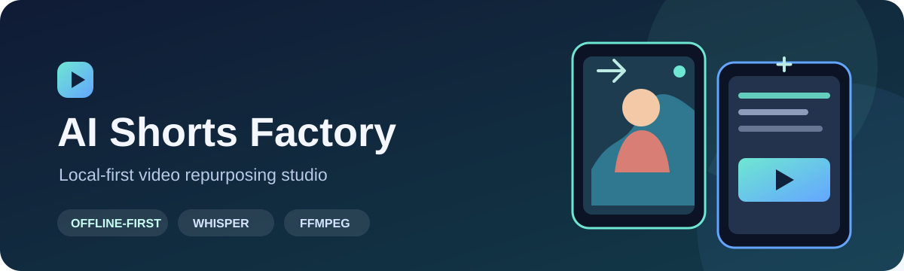

# AI Shorts Factory

AI Shorts Factory adalah aplikasi Windows untuk mengolah video panjang menjadi klip pendek. Prosesnya berjalan di komputer sendiri: transkripsi memakai faster-whisper, lalu klip bisa diatur, diberi subtitle, dan dirender dengan FFmpeg.

Server hanya berjalan di `127.0.0.1`. Video tidak diunggah ke cloud dan aplikasi tidak memakai API AI eksternal atau analitik.

## Kondisi saat ini

Proyek, perpustakaan video, transkripsi, dan fitur dasar Smart Crop & Render sudah tersedia. Batch render dan Export Center juga sudah ada dalam bentuk dasar. Deteksi klip otomatis dengan Qwen, editor timeline, template, thumbnail, diarization, dan kontrol jeda/lanjut antrean belum tersedia. Catatan fitur dan pengujian ada di [DEVELOPMENT_STATUS.md](DEVELOPMENT_STATUS.md).

## Yang bisa dilakukan

- Mengelola proyek dan video: unggah beberapa file MP4, MOV, MKV, WEBM, atau AVI; cari, filter, urutkan, ganti nama, dan hapus video.
- Melihat kondisi komputer: CPU, RAM, disk, GPU NVIDIA, NVENC, dan kompatibilitas CUDA. Aplikasi hanya memakai NVENC jika uji encode berhasil.
- Membuat transkrip dengan faster-whisper, mengedit teks dan timestamp, lalu mengekspornya sebagai SRT, VTT, atau TXT. Model baru diunduh setelah pengguna menyetujui ukuran unduhan dan kebutuhan ruang disk.
- Membuat klip secara manual, mengatur crop dan layout, menambahkan subtitle, lalu merender dengan H.264 atau H.265.
- Mengantrekan beberapa klip untuk dirender dan mengunduh hasilnya dari Export Center.

Rincian fitur yang belum selesai dan batasan yang sudah diketahui dicatat di [DEVELOPMENT_STATUS.md](DEVELOPMENT_STATUS.md).

## Menjalankan di Windows

Prasyarat: Windows 10/11, Python 3.11–3.13, Node.js 20+, serta FFmpeg dan FFprobe di `PATH`. GPU NVIDIA tidak wajib.

```bat
scripts\install.bat
scripts\start.bat
```

`install.bat` menyiapkan virtual environment, dependensi, konfigurasi, database, dan frontend. Setelah `start.bat` selesai, buka http://127.0.0.1:8000. Untuk menghentikan aplikasi, jalankan `scripts\stop.bat`.

Model Whisper bawaan adalah `large-v3-turbo` (sekitar 1,6 GB). Unduh dari halaman **Transkripsi** atau jalankan `scripts\download_models.bat`; model tidak diunduh otomatis.

Skrip lain yang tersedia:

```text
scripts\check_gpu.bat
scripts\download_models.bat
```

## Menggunakan salinan dari GitHub

Jalankan perintah berikut dari PowerShell setelah memasang prasyarat:

```powershell
git clone https://github.com/ShnyVirus-0x/AiFactory.git
cd AiFactory
scripts\install.bat
scripts\start.bat
```

Buat proyek, unggah video yang Anda miliki atau berhak olah, buat klip, lalu render. Aplikasi berjalan di komputer Anda; repositori GitHub ini bukan situs demo yang di-host.

## Pengembangan dan tes

Dari folder proyek:

```powershell
python -m pip install -r backend\requirements-dev.txt
python -m pytest backend\tests tests\integration -q
npm --prefix frontend install
npm --prefix frontend test
```

Gunakan OpenCV 4.x. Versi 5.x dari PyPI tidak menyertakan cascade wajah yang dipakai aplikasi.

## Catatan keamanan

Server hanya bind ke `127.0.0.1`. Aplikasi memeriksa Origin untuk WebSocket/CORS, menyimpan nama file dengan nama acak, membatasi akses file agar tidak keluar dari folder yang diizinkan, dan hanya menyediakan unduhan dari `storage/outputs`. Argumen FFmpeg dikirim tanpa shell, teks subtitle dibersihkan sebelum ditulis ke ASS, dan log JSON menyamarkan rahasia.

Gunakan hanya video yang Anda miliki atau berhak olah.
